# Science Fair Project Guide – 20 Models
**For Classes 7, 8 and 9**  
**Includes:** model photographs, required materials and a short presentation paragraph for each project.

> **How to use this file:** Keep the `images` folder in the same folder as this Markdown file. The pictures below use relative image links, so they will display in Markdown apps that support local images (for example, VS Code, Obsidian and many GitHub repositories). The ZIP package contains both the Markdown file and its images folder.

## Quick reference: project names and materials

| No. | Model name | Main materials |
|---:|---|---|
| 1 | Motorized DNA Double Helix Model | Cardboard or plywood base; DC geared motor (3–6 V); battery holder and batteries; on/off switch; connecting wires; etc. |
| 2 | Working Escalator Model | Corrugated cardboard or foam board; cardboard step pieces or a small linked-step chain; two rollers or pulleys; DC geared motor; battery holder and batteries; etc. |
| 3 | Hologram Illusion Display | Clear acrylic or transparent plastic sheet; cardboard or foam-board enclosure; smartphone or tablet; suitable hologram/illusion video; black chart paper; etc. |
| 4 | Human Body and Brain Model | Large cardboard, plywood or foam-board base; thermocol/foam sheet or papier-mâché; modelling clay; paints and brushes; coloured yarn, string or flexible tubing for vessels; etc. |
| 5 | Hydraulic JCB Excavator | Cardboard, plywood or foam-board base; ice-cream sticks or wooden strips; 4–6 large syringes; flexible plastic tubes; water; etc. |
| 6 | Kaleidoscope | Cardboard tube; three narrow mirror strips or reflective acrylic strips; transparent plastic discs; small coloured beads or sequins; translucent/frosted plastic or tracing paper; etc. |
| 7 | Volcano Eruption Model | Cardboard or plywood base; small plastic bottle; newspaper and papier-mâché or modelling clay; paints; baking soda; etc. |
| 8 | Map Explorer – Electrical Geography Quiz Board | Printed map (the pictured example is a map of Europe); cardboard, foam board or plywood backing; metal brads/screws/contact points; country-name labels; insulated connecting wires; etc. |
| 9 | Molecular Structure Model | Thermocol/foam balls or modelling clay in different colours; toothpicks or short wooden/plastic rods; paints; cardboard or wooden base; labels; etc. |
| 10 | Simple Homopolar Motor | One AA battery; small neodymium disc magnet; bare copper wire that can be bent into the shown shape; optional small base or holder; wire cutters/pliers; etc. |
| 11 | Newton’s Cradle | Five equal-sized steel balls; strong thin thread or fishing line; wooden or cardboard frame; support rods; glue or screws; etc. |
| 12 | Satellite Model | Small cardboard or foam-board box for the satellite body; blue card or mini solar cells for solar panels; aluminium foil; ice-cream sticks or thin rods for antennae; wires; etc. |
| 13 | Solar System Model | Eight thermocol/foam balls in different sizes; large base board; paints and brushes; wooden skewers or wire supports; string or wire for orbit paths; etc. |
| 14 | Simple Refracting Telescope | One convex objective lens with a longer focal length; one convex eyepiece lens with a shorter focal length; two cardboard tubes that slide inside one another; lens holders; black paper; etc. |
| 15 | Wireless Power Transfer Demonstration | Transmitter coil and receiver coil made with insulated copper wire; low-voltage wireless-power oscillator/transmitter module; receiver LED with suitable resistor or receiver module; low-voltage battery or regulated supply; connecting wires; etc. |
| 16 | Archimedes Screw Water Pump | Transparent PVC pipe or clear tube; flexible plastic hose or spiral strip to form the screw; central rod; hand crank or low-speed geared motor; support frame; etc. |
| 17 | Buzz Wire Game | Thick bare metal wire for the shaped course; metal wire loop/handle; insulated handle; low-voltage battery; buzzer; etc. |
| 18 | City Model | Large cardboard or foam-board base; small cartons for buildings; coloured paper and paints; road markings; toy cars and train; etc. |
| 19 | Working Conveyor Belt | DC geared motor; two rollers; rubber belt or wide elastic strip; wooden or cardboard frame; shafts/axles; etc. |
| 20 | Day and Night Demonstration Model | Globe or painted foam sphere; bright LED lamp or torch to represent the Sun; stable stands; low-voltage battery and switch for the lamp; optional low-speed motor and holder to rotate the globe; etc. |

---

## Model details and student presentation paragraphs

## 1. Motorized DNA Double Helix Model
**Suitable class:** 8–9  
**Scientific concept:** DNA structure, base pairing and genetic information

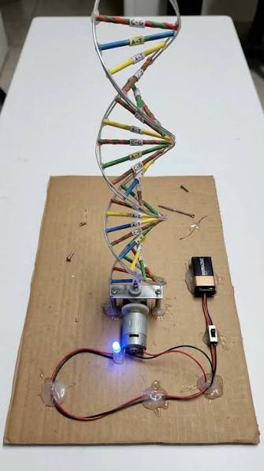

**Required materials**
Cardboard or plywood base; DC geared motor (3–6 V); battery holder and batteries; on/off switch; connecting wires; two flexible wires or rods for the strands; coloured straws, beads or small foam pieces for the base pairs; glue; labels.

**Short paragraph to present at the science fair**
> Good morning. This model shows the double-helix structure of DNA, the molecule that carries genetic information in living things. The two twisting strands are joined by pairs of bases: adenine pairs with thymine, and cytosine pairs with guanine. The small motor slowly rotates the model so that we can see the twisted shape more clearly. DNA contains instructions that help organisms grow, function and pass characteristics from one generation to the next.

**Teacher / safety note:** Use a low-voltage geared motor and secure the rotating structure so it cannot wobble or catch fingers.

---

## 2. Working Escalator Model
**Suitable class:** 8–9  
**Scientific concept:** Continuous motion, gears, belts and energy conversion

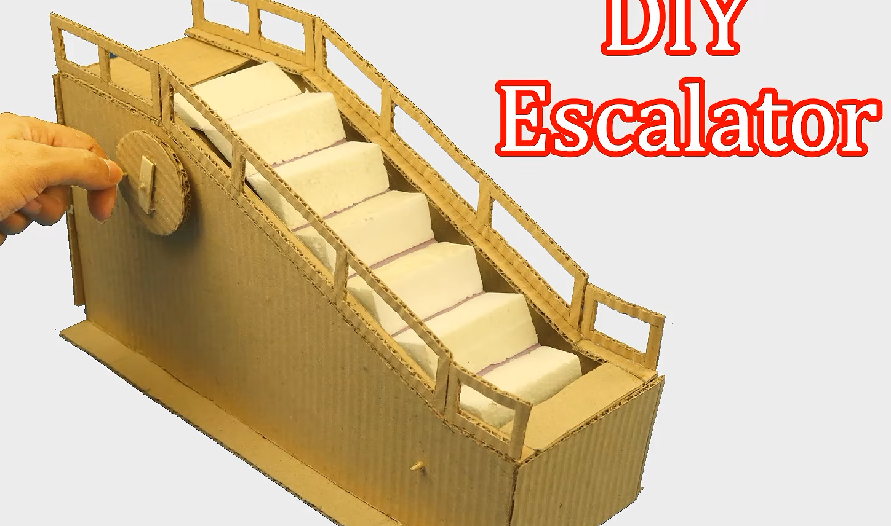

**Required materials**
Corrugated cardboard or foam board; cardboard step pieces or a small linked-step chain; two rollers or pulleys; DC geared motor; battery holder and batteries; switch; wooden skewers or metal rods for axles; rubber belt or suitable looped chain; glue; cutter; paint or labels.

**Short paragraph to present at the science fair**
> This is a small working model of an escalator, which is used to move people between different floor levels. The motor turns a belt or chain mechanism that carries the steps around a continuous path. The steps are guided so that they remain nearly horizontal while moving along the sloping section. This model demonstrates how electrical energy is converted into mechanical motion and how machines make transport easier in places such as shopping centres and railway stations.

**Teacher / safety note:** Keep fingers away from the moving belt, rollers and step mechanism. A hand-operated version can be used if a motorised mechanism is difficult to build.

---

## 3. Hologram Illusion Display
**Suitable class:** 7–9  
**Scientific concept:** Reflection of light and optical illusion

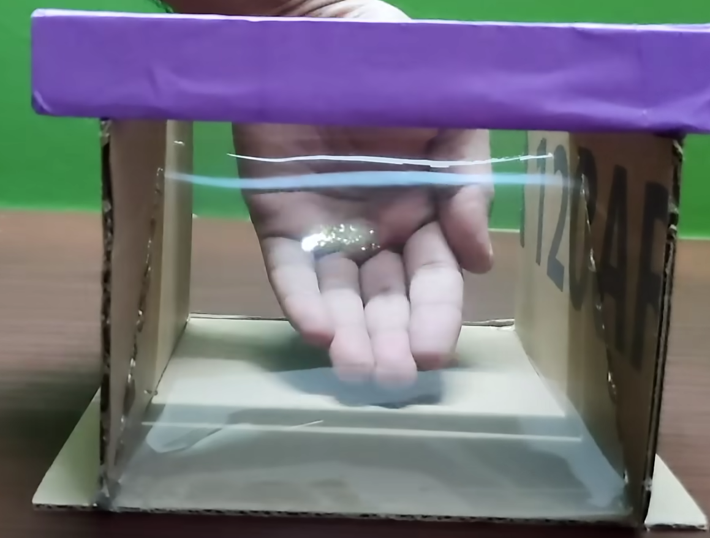

**Required materials**
Clear acrylic or transparent plastic sheet; cardboard or foam-board enclosure; smartphone or tablet; suitable hologram/illusion video; black chart paper; ruler; tape; glue; cutter; optional LED lighting.

**Short paragraph to present at the science fair**
> This project creates a hologram-like visual illusion using light and a transparent surface. A specially prepared video is shown on a phone, and the image is reflected by the clear plastic or acrylic arrangement so that it appears to float inside the display. It is an optical illusion rather than a true hologram, but it helps us understand how reflection and viewing angle can create a three-dimensional-looking image. The dark background makes the reflected image easier to see.

**Teacher / safety note:** Call it a hologram illusion or Pepper’s-Ghost-style display, not a true 3D hologram. The exact sheet arrangement should match the video and design being used.

---

## 4. Human Body and Brain Model
**Suitable class:** 7–9  
**Scientific concept:** Human organs, body systems and brain structure

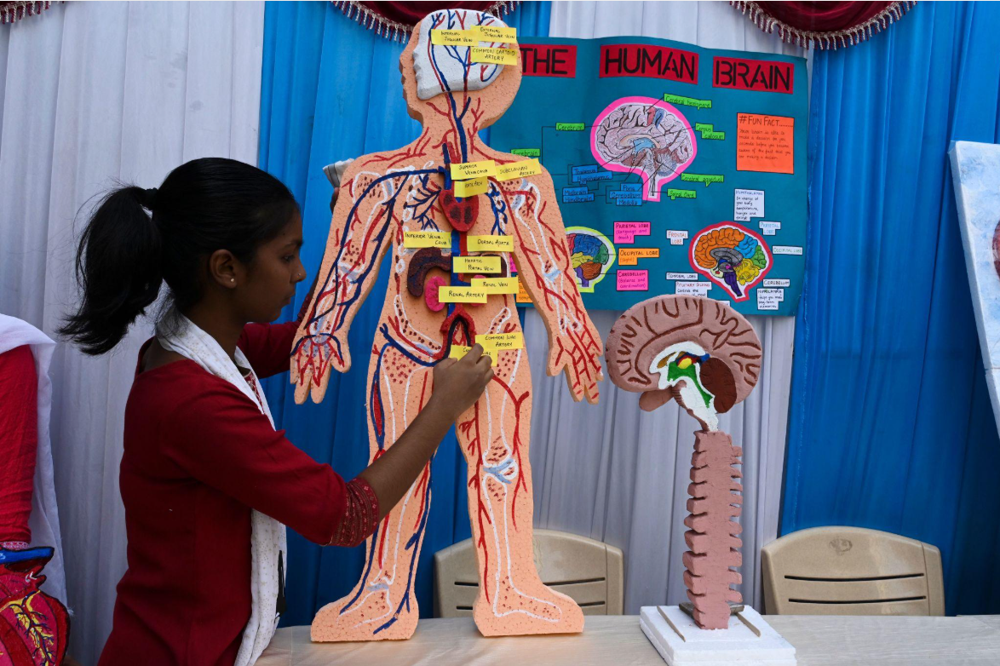

**Required materials**
Large cardboard, plywood or foam-board base; thermocol/foam sheet or papier-mâché; modelling clay; paints and brushes; coloured yarn, string or flexible tubing for vessels; printed brain/organ diagrams; labels; glue; scissors; markers.

**Short paragraph to present at the science fair**
> This model introduces the major organs of the human body and shows where they are located. The brain is the control centre of the nervous system: it receives information, processes it and helps coordinate our actions and body functions. Other organs, such as the heart and lungs, work together to keep the body alive. By looking at the model, we can learn how different organs have different jobs but depend on one another.

**Teacher / safety note:** Label only the organs and brain parts that students can correctly identify and explain.

---

## 5. Hydraulic JCB Excavator
**Suitable class:** 8–9  
**Scientific concept:** Pascal’s law and hydraulic machines

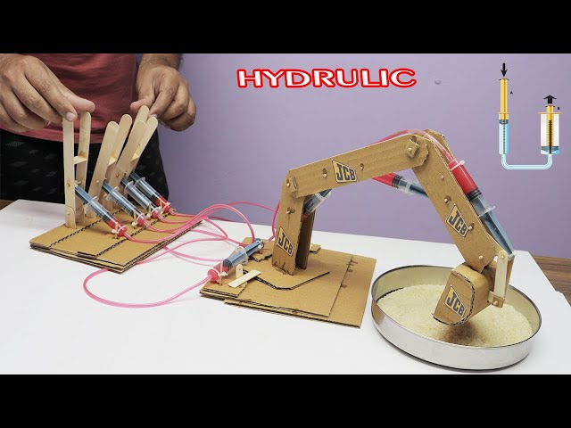

**Required materials**
Cardboard, plywood or foam-board base; ice-cream sticks or wooden strips; 4–6 large syringes; flexible plastic tubes; water; wooden skewers or bolts for pivots; small scoop/bucket; glue or hot glue; tape; cutter; optional paint.

**Short paragraph to present at the science fair**
> This is a model of a hydraulic excavator. It uses syringes connected by tubes filled with water. When we push one syringe, pressure is transmitted through the liquid and moves another syringe, which makes the arm or bucket move. This demonstrates Pascal’s law: pressure applied to an enclosed liquid is transmitted through the liquid. Hydraulic machines use this principle to lift and move heavy loads.

**Teacher / safety note:** Fill the paired syringe-and-tube circuits with water and remove as much trapped air as possible. Keep the load light and supervise cutting and hot-glue work.

---

## 6. Kaleidoscope
**Suitable class:** 7–8  
**Scientific concept:** Multiple reflection of light

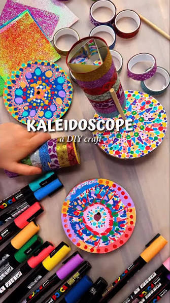

**Required materials**
Cardboard tube; three narrow mirror strips or reflective acrylic strips; transparent plastic discs; small coloured beads or sequins; translucent/frosted plastic or tracing paper; cardboard end caps; decorative paper; tape; glue; scissors.

**Short paragraph to present at the science fair**
> A kaleidoscope produces beautiful patterns using the principle of multiple reflection. Three reflective strips are arranged inside the tube to form a triangular arrangement. Light enters from one end and reflects repeatedly between the mirrors, creating a symmetrical pattern. When we rotate the kaleidoscope, the coloured pieces move and a new pattern appears.

**Teacher / safety note:** Cover mirror edges carefully so that no sharp edges are exposed.

---

## 7. Volcano Eruption Model
**Suitable class:** 7–8  
**Scientific concept:** Volcano structure and gas-producing reaction demonstration

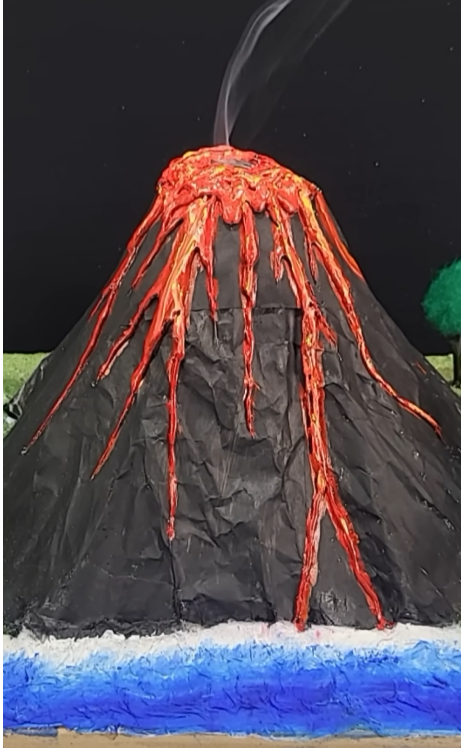

**Required materials**
Cardboard or plywood base; small plastic bottle; newspaper and papier-mâché or modelling clay; paints; baking soda; vinegar; a little dishwashing liquid; red/orange food colour; tray; spoon and measuring cup.

**Short paragraph to present at the science fair**
> This model represents a volcano and shows how an eruption can send material down its sides. In our demonstration, baking soda reacts with vinegar and produces carbon dioxide gas. The gas creates bubbles and pushes the coloured foam out of the opening. This is a safe classroom simulation of an eruption, not the actual process inside a volcano, where hot magma, dissolved gases and pressure are involved.

**Teacher / safety note:** Use small quantities on a tray under teacher supervision. The reaction is a classroom simulation; do not use flames, sealed containers or strong chemicals.

---

## 8. Map Explorer – Electrical Geography Quiz Board
**Suitable class:** 7–9  
**Scientific concept:** Geography recall and simple electric circuits

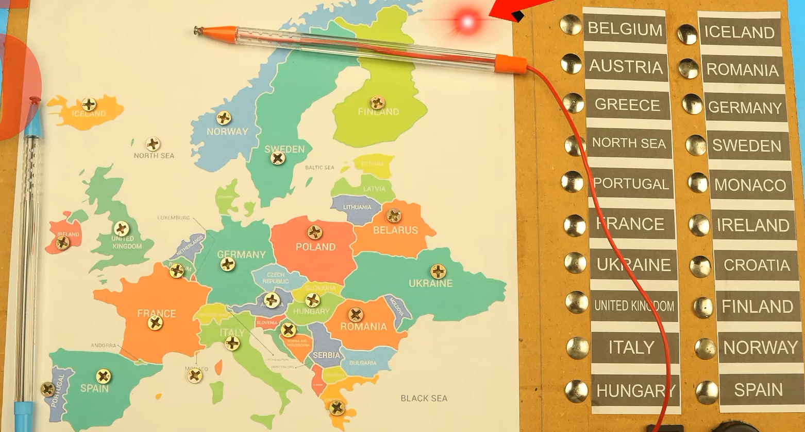

**Required materials**
Printed map (the pictured example is a map of Europe); cardboard, foam board or plywood backing; metal brads/screws/contact points; country-name labels; insulated connecting wires; LED; suitable current-limiting resistor; low-voltage battery; buzzer (optional); switch; two insulated probe wires; glue and marker.

**Short paragraph to present at the science fair**
> This is an interactive geography quiz board. One side shows a map and the other side has country names. The participant uses the two probes to match a country with its correct location. When the correct contacts are connected, the electric circuit is completed and the LED or buzzer gives a signal. The project combines map-reading skills with the basic idea of an electric circuit.

**Teacher / safety note:** Use a low-voltage battery and a current-limiting resistor with the LED. Check the contact pairs carefully so only correct matches complete the circuit.

---

## 9. Molecular Structure Model
**Suitable class:** 7–9  
**Scientific concept:** Atoms, chemical elements and bonding

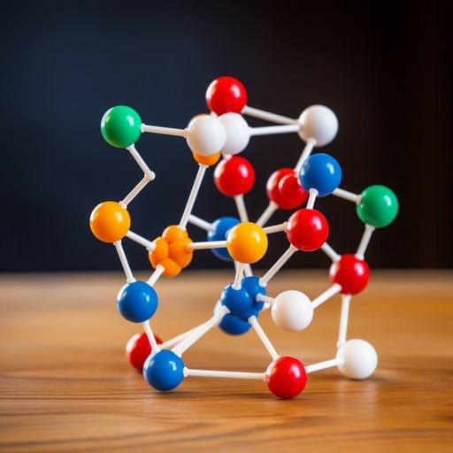

**Required materials**
Thermocol/foam balls or modelling clay in different colours; toothpicks or short wooden/plastic rods; paints; cardboard or wooden base; labels; marker; glue. Select a particular molecule and prepare the correct number and arrangement of atoms before building.

**Short paragraph to present at the science fair**
> This model represents a molecule, which is made when two or more atoms are joined by chemical bonds. The coloured balls represent different types of atoms, and the connecting rods represent bonds between them. The arrangement of atoms is important because it helps determine a substance’s properties. Our model is a simplified, enlarged representation that makes a very small structure easier to understand.

**Teacher / safety note:** The pictured model does not identify a particular molecule. Students should choose a named molecule, then verify its formula and structure before labelling the model.

---

## 10. Simple Homopolar Motor
**Suitable class:** 8–9  
**Scientific concept:** Magnetic force on a current-carrying conductor

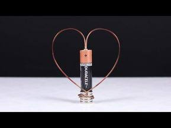

**Required materials**
One AA battery; small neodymium disc magnet; bare copper wire that can be bent into the shown shape; optional small base or holder; wire cutters/pliers; eye protection for wire shaping.

**Short paragraph to present at the science fair**
> This is a simple homopolar motor. When the copper wire touches the battery and the magnet, an electric current flows through the wire in a magnetic field. The interaction between the current and the magnetic field produces a force that makes the wire move around the battery. It is a simple demonstration of how electrical energy can be converted into motion.

**Teacher / safety note:** Run it only for a few seconds at a time under close supervision. The wire can heat up because the arrangement draws a large current. Disconnect it immediately if the battery or wire becomes warm.

---

## 11. Newton’s Cradle
**Suitable class:** 7–9  
**Scientific concept:** Transfer of momentum and energy in collisions

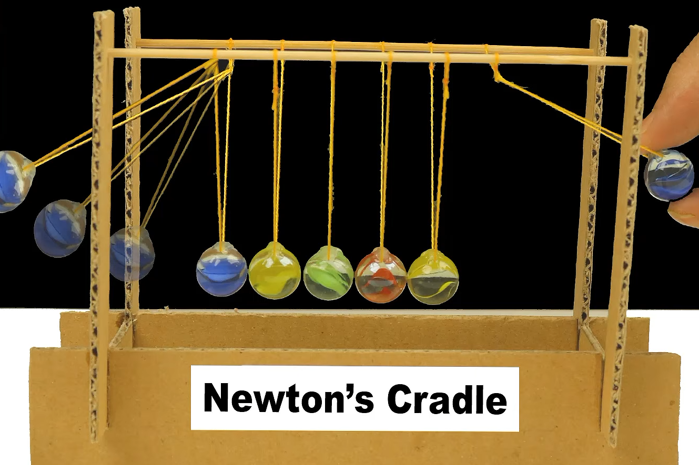

**Required materials**
Five equal-sized steel balls; strong thin thread or fishing line; wooden or cardboard frame; support rods; glue or screws; ruler; pliers; optional labels.

**Short paragraph to present at the science fair**
> Newton’s cradle demonstrates what happens when balls collide. When we lift and release one ball, it strikes the row and the ball at the other end swings outward. The motion is explained by the transfer of momentum and energy through the collisions. In a real model, some energy is also lost as sound, heat and air resistance, so the balls gradually stop.

**Teacher / safety note:** Use balls of similar size and mass, and suspend them at equal heights so they touch in a straight line.

---

## 12. Satellite Model
**Suitable class:** 7–9  
**Scientific concept:** Satellites, communication and solar power in space

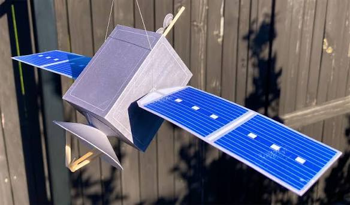

**Required materials**
Small cardboard or foam-board box for the satellite body; blue card or mini solar cells for solar panels; aluminium foil; ice-cream sticks or thin rods for antennae; wires; optional small LED and battery; glue; paint; labels; display stand.

**Short paragraph to present at the science fair**
> This model represents an artificial satellite that can travel around Earth. Satellites are used for communication, weather forecasting, navigation, scientific research and observing our planet. Many satellites use solar panels to convert sunlight into electrical energy for their instruments. The model shows some external parts of a satellite, including its main body, solar panels and antennae.

**Teacher / safety note:** This is a display model unless a working radio or electronic function is added. Do not imply that the model demonstrates an actual orbit.

---

## 13. Solar System Model
**Suitable class:** 7–8  
**Scientific concept:** The Sun, planets and their order in the solar system

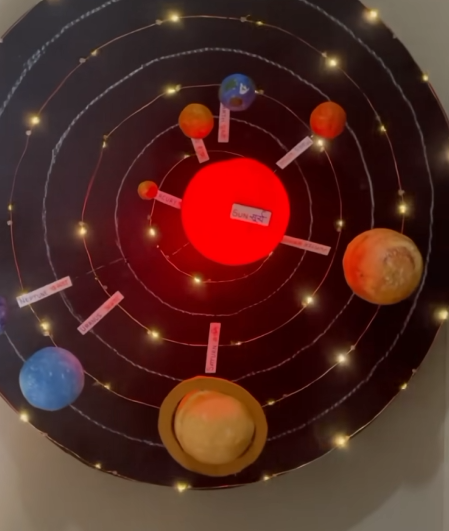

**Required materials**
Eight thermocol/foam balls in different sizes; large base board; paints and brushes; wooden skewers or wire supports; string or wire for orbit paths; labels; glue; optional LEDs, battery and switch.

**Short paragraph to present at the science fair**
> This model shows the Sun and the eight planets of our solar system in their order from the Sun: Mercury, Venus, Earth, Mars, Jupiter, Saturn, Uranus and Neptune. The planets travel around the Sun in separate orbits. The model helps us compare their order and approximate relative sizes, although the distances and sizes are not shown to the same scale.

**Teacher / safety note:** Clearly label the planets. If the model uses lights or a motor, explain those as display features rather than as a scale representation of the real solar system.

---

## 14. Simple Refracting Telescope
**Suitable class:** 8–9  
**Scientific concept:** Refraction and magnification by lenses

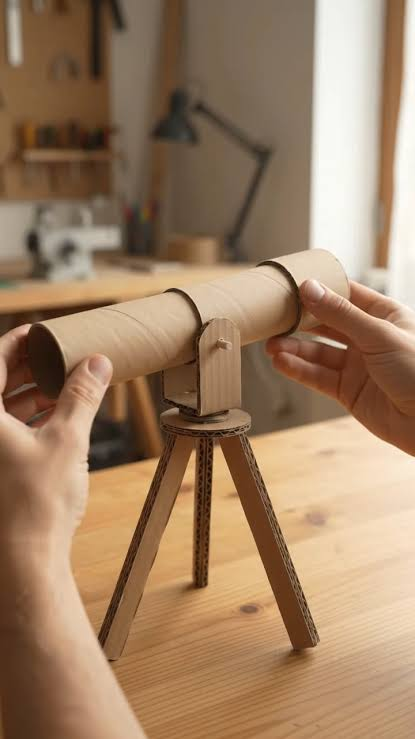

**Required materials**
One convex objective lens with a longer focal length; one convex eyepiece lens with a shorter focal length; two cardboard tubes that slide inside one another; lens holders; black paper; tape; glue; tripod or stable stand.

**Short paragraph to present at the science fair**
> This is a simple refracting telescope. It uses lenses to collect light from a distant object and form an image that we can view through the eyepiece. The objective lens forms an image, and the eyepiece magnifies it for the observer. By sliding the tubes, we change the distance between the lenses to bring the image into focus.

**Teacher / safety note:** Never point the telescope at the Sun. Direct sunlight through a telescope can cause permanent eye injury.

---

## 15. Wireless Power Transfer Demonstration
**Suitable class:** 9  
**Scientific concept:** Electromagnetic induction and energy transfer

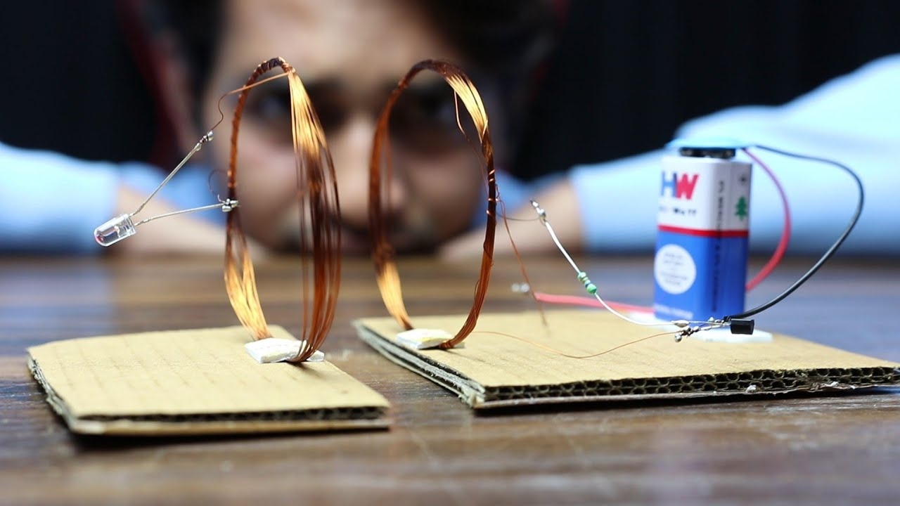

**Required materials**
Transmitter coil and receiver coil made with insulated copper wire; low-voltage wireless-power oscillator/transmitter module; receiver LED with suitable resistor or receiver module; low-voltage battery or regulated supply; connecting wires; cardboard base; tape; labels.

**Short paragraph to present at the science fair**
> This project demonstrates how electrical energy can be transferred between two coils without a direct wire connection. The transmitter circuit sends a changing current through its coil, producing a changing magnetic field. This changing field induces a voltage in the nearby receiver coil, which can light an LED. The distance and alignment between the coils affect how much energy is transferred.

**Teacher / safety note:** Use a purpose-built low-voltage oscillator or wireless-power module. A coil connected directly to a battery produces no continuous changing magnetic field and can overheat.

---

## 16. Archimedes Screw Water Pump
**Suitable class:** 7–9  
**Scientific concept:** A rotating helical surface lifting water

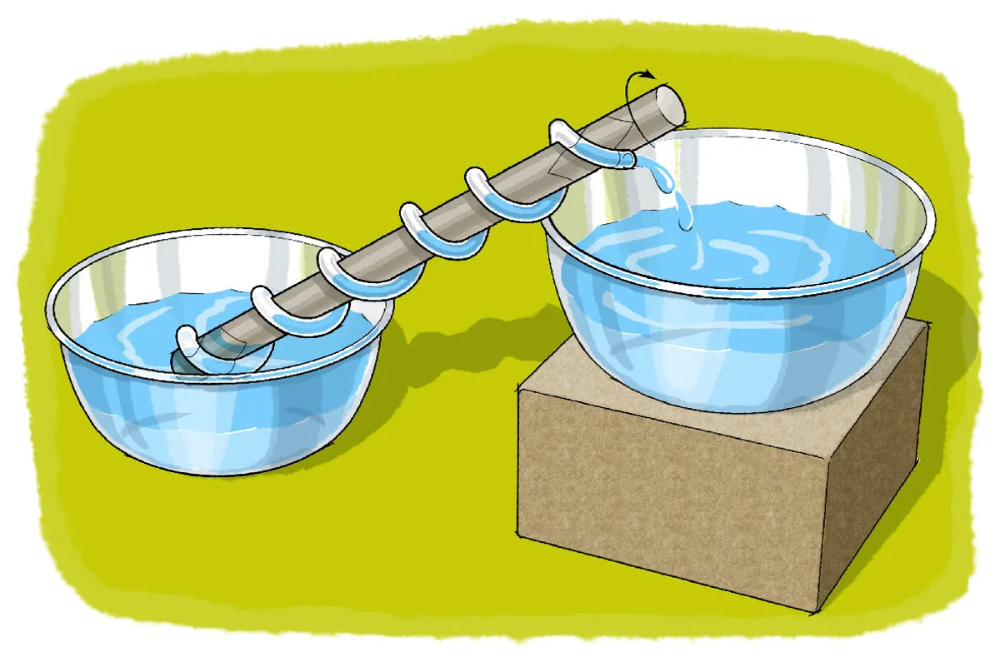

**Required materials**
Transparent PVC pipe or clear tube; flexible plastic hose or spiral strip to form the screw; central rod; hand crank or low-speed geared motor; support frame; two water containers; water; base board; glue or clamps.

**Short paragraph to present at the science fair**
> This model demonstrates an Archimedes screw, a simple machine used to lift water from a lower level to a higher level. When the screw turns, pockets of water are carried upward along the spiral path inside the tube. The device has been used for irrigation and water movement. It shows how a rotating mechanism can move water without using a conventional pump impeller.

**Teacher / safety note:** Keep the frame stable and use a slow hand crank or low-voltage geared motor. Prevent water from reaching electrical components.

---

## 17. Buzz Wire Game
**Suitable class:** 7–9  
**Scientific concept:** Electric circuits and electrical continuity

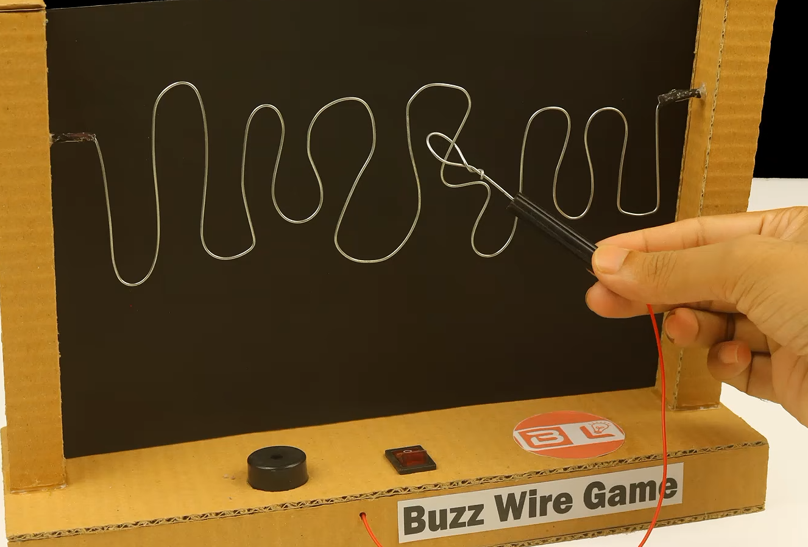

**Required materials**
Thick bare metal wire for the shaped course; metal wire loop/handle; insulated handle; low-voltage battery; buzzer; LED and suitable resistor; connecting wires; switch; cardboard or wooden base; tape and pliers.

**Short paragraph to present at the science fair**
> This is a skill game based on an electric circuit. The player moves the metal loop along the shaped wire without touching it. If the loop touches the wire, the circuit is completed and the buzzer or LED gives a signal. The game helps us understand how a switch works and how touching two conductive parts can complete an electric circuit.

**Teacher / safety note:** Use only a low-voltage battery. Cover sharp wire ends and make sure the buzzer and LED are wired correctly.

---

## 18. City Model
**Suitable class:** 7–9  
**Scientific concept:** Urban planning, transport, infrastructure and energy use

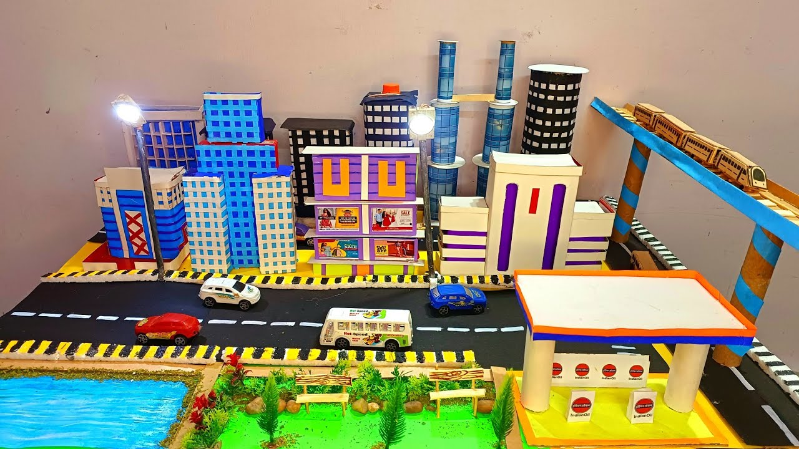

**Required materials**
Large cardboard or foam-board base; small cartons for buildings; coloured paper and paints; road markings; toy cars and train; track or elevated bridge (if included); LEDs for streetlights; wires; low-voltage battery; switches; toy trees; glue; labels.

**Short paragraph to present at the science fair**
> This model represents a city and some of the facilities people use every day. It includes buildings, roads, transport, streetlights and public spaces. A well-planned city needs safe transport, reliable energy, clean water, waste management and green areas. Our model helps us discuss how different parts of a city are connected and how planning can make urban life safer and more sustainable.

**Teacher / safety note:** If the model includes lights or a moving train, demonstrate those features separately and explain which parts are working and which are display models.

---

## 19. Working Conveyor Belt
**Suitable class:** 8–9  
**Scientific concept:** Rotational motion, friction and material handling

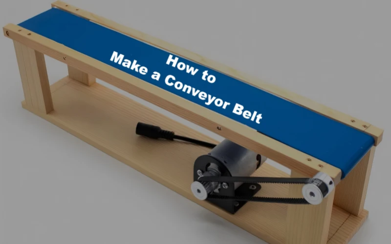

**Required materials**
DC geared motor; two rollers; rubber belt or wide elastic strip; wooden or cardboard frame; shafts/axles; pulleys or drive belt; battery holder and batteries; switch; connecting wires; glue or screws; small lightweight objects to transport.

**Short paragraph to present at the science fair**
> This is a small conveyor belt, similar to the systems used in factories, warehouses and airports. A motor turns one roller, which moves the continuous belt around the rollers. Objects placed on the belt are carried from one end to the other. The model demonstrates how rotational motion and friction can be used to transport materials efficiently.

**Teacher / safety note:** Keep fingers, hair and loose clothing away from the rollers and moving belt. Use only lightweight objects.

---

## 20. Day and Night Demonstration Model
**Suitable class:** 7–8  
**Scientific concept:** Earth’s rotation and the cycle of day and night

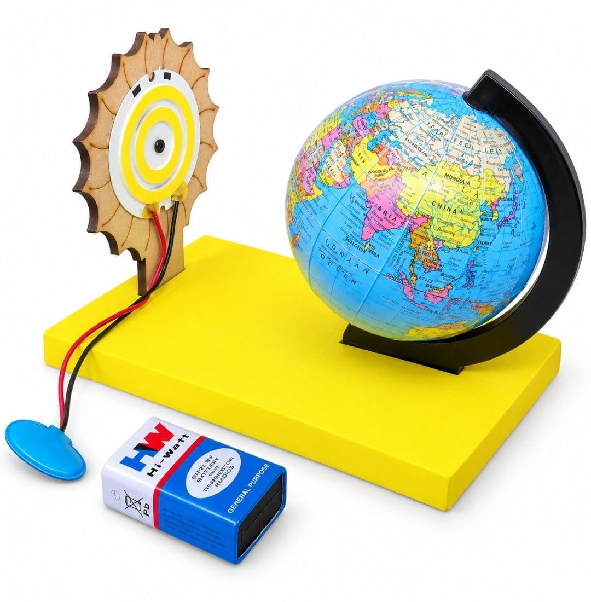

**Required materials**
Globe or painted foam sphere; bright LED lamp or torch to represent the Sun; stable stands; low-voltage battery and switch for the lamp; optional low-speed motor and holder to rotate the globe; labels; cardboard base.

**Short paragraph to present at the science fair**
> This model explains why we have day and night. The Sun lights up the half of Earth that faces it, while the opposite half is in darkness. Earth rotates on its axis, and different places move into and out of sunlight during this rotation. One complete rotation takes about 24 hours, producing the daily cycle of day and night.

**Teacher / safety note:** Keep the lamp fixed as the Sun and rotate the Earth. Do not move the Sun around Earth for this demonstration.

---

## General instructions for students

1. Prepare the model neatly and make sure it can be demonstrated reliably.
2. Learn the scientific principle; do not simply memorise the paragraph.
3. Explain what the model demonstrates, how it works and where the idea is used in real life.
4. Label important parts and keep the materials list with the model.
5. Use recycled materials where suitable, and keep the display area clean.

## General safety instructions

- Use low-voltage batteries only. Never connect a student model directly to household mains electricity.
- Keep fingers, hair and loose clothing away from moving belts, gears, rollers and rotating parts.
- Use cutters, hot glue and sharp tools only with adult supervision.
- Do not point a telescope at the Sun.
- For the homopolar motor, use only brief demonstrations and disconnect it if the battery or wire warms up.
- Keep water away from batteries, motors and exposed electrical connections.
- Chemical demonstrations, including the volcano, should use small quantities and be supervised by a teacher.

---

*Prepared as a classroom science-fair handout. Budgets and exact quantities depend on the size and design chosen by each student.*
